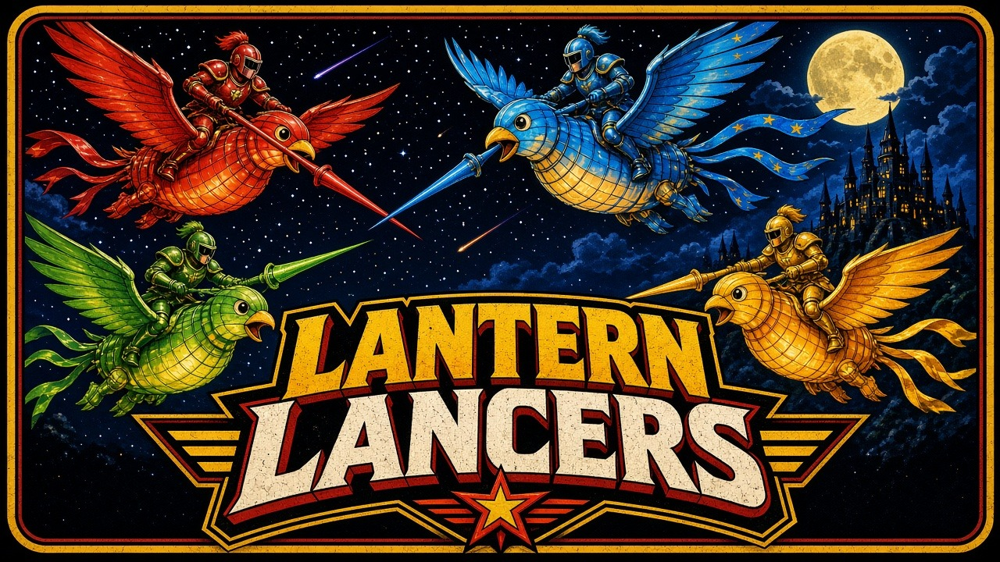

# Lantern Lancers

Joust on glowing lantern-birds. Pop a rival's lantern by striking from above, stay out of the fog, and be the last rider aloft.

Four players share one keyboard (or four gamepads) in a free-for-all. Empty seats can be filled by bots, so a single player can fly against the flock. The whole game runs offline in the browser: canvas, vanilla ES modules, and sounds synthesized on the fly.

## Launch

The game uses ES modules, so open it through the tiny local server rather than as a file. Default address: [http://127.0.0.1:8811/](http://127.0.0.1:8811/). If that port is taken, the server steps to the next free port.

Python 3 is the only dependency. Each launcher checks for it and prints a short note if it is missing.

| Platform | Launcher |
| --- | --- |
| macOS | Double-click `launch-mac.command` |
| Windows | Double-click `launch-windows.bat` |
| Linux | `./launch-linux.sh` |
| Already in a terminal | `python3 server.py` |

Add `--no-browser` to serve without opening a window. `--port 8820` requests a specific port (still falling forward if it is busy).

## Controls

Up and the action key both flap. Gravity does the rest. Down dives through platforms. Left and right steer. The secondary key is a short lance dash with a 1.5 second cooldown.

| Player | Steer | Flap | Dash |
| --- | --- | --- | --- |
| P1 Amber | W A S D | F | G |
| P2 Crimson | Arrow keys | `/` | `.` |
| P3 Tide | I J K L | `;` | `'` |
| P4 Violet | Numpad 8 4 5 6 | Numpad 0 | Numpad Enter |

Esc pauses. M mutes. Enter starts a match, confirms menus, and rematches.

Gamepads in browser slots 0–3 map to P1–P4: left stick or D-pad to steer, A to flap, B to dash, Start to pause. While a pad is connected it overrides that player's keyboard keys, and the HUD shows a pad icon. Unplugging returns the keyboard on the next frame.

The controls screen rebinds every steer, flap, and dash key. Bindings, volume, mute, and the round-win target are stored in `localStorage` under `lanternlancers.settings`. Escape stays the pause key.

## Rules

The arena is a side-view night sky with floating platforms, wraparound horizontal edges, and a fog bank along the bottom.

- Every rider starts a round with 3 lanterns.
- When two riders collide, the higher lance pops one lantern off the other. Equal height (a few pixels) bounces both of them back.
- Touching the fog costs one lantern, then throws the rider upward so the fog cannot empty them in a single graze.
- At 0 lanterns the rider falls out of the round.
- Ember pickups restore one lantern, never past 3.
- A round ends when one rider is still aloft, or after 120 seconds.

## Scoring

On a timeout, the rider with the most lanterns wins the round. If lanterns are tied, the most pops wins. If both match, the round is a draw and nobody scores it.

The first rider to 3 round wins takes the match. Settings can change that target to anywhere from 1 to 5. The match screen lists the standings and offers a rematch.

## arcade.json

`arcade.json` is the cabinet manifest: display name, id `lanternlancers`, cover and icon paths, per-OS launch commands, web entry `index.html`, 4 players, minimum 1, keyboard and gamepad input, version `1.0.0`, and port `8811`.

## Tests

Core rules live in `src/core/` and do not touch the DOM, canvas, or network, so they run in Node:

```bash
node --test tests/*.test.js
python3 -m unittest tests/test_server.py
```

The JavaScript suite covers movement and collision, scoring, round and match wins, elimination, ember pickups, seeded RNG, keyboard and gamepad mapping, bot behavior, and the arcade manifest. The Python test starts `server.py` and fetches `index.html`. GitHub Actions runs both on every push and pull request.

## License

MIT. See [LICENSE](LICENSE).
